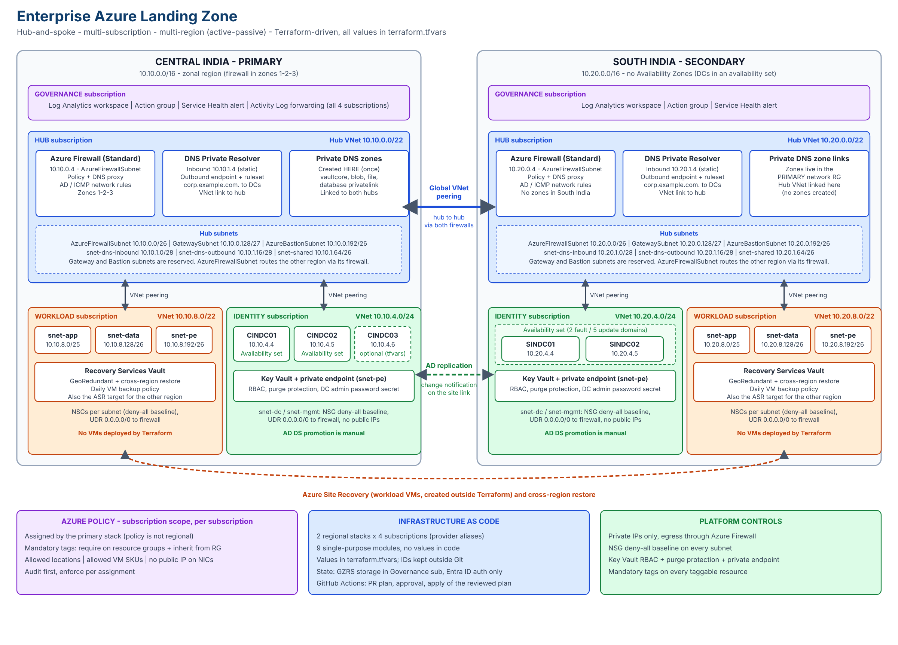

# Azure Landing Zone - Terraform

[](https://github.com/hitulgala/azure-landing-zone-terraform/actions/workflows/terraform-plan.yml)
[](https://github.com/hitulgala/azure-landing-zone-terraform/actions/workflows/terraform-apply.yml)



Hub-and-spoke Azure landing zone for **Central India (primary)** and **South India (secondary, active-passive)** across four subscriptions: Governance, Hub, Identity and Workload. It is deployed through a **GitHub Actions pipeline**: every change is planned on a pull request, reviewed, approved, and only then applied.

**Design rule:** every deployment value lives in `terraform.tfvars` (names, address spaces, NSG rules, routes, firewall rules, VM settings, e-mail addresses). The `.tf` files only wire modules together. The only exception is your **tenant and subscription IDs**, which are kept out of Git (see [Configuration](#configuration)).

## What it builds
| Subscription | Resources |
|--------------|-----------|
| Governance | Resource group, Log Analytics workspace, action group, Service Health alert, Activity Log forwarding (primary only), Azure Policy assignments (primary only) |
| Hub | VNet, Azure Firewall Standard with policy and rules, DNS Private Resolver, Private DNS zones (created in primary, linked from secondary), cross-region routing, hub-to-hub peering |
| Identity | VNet, NSGs, route table, Key Vault with private endpoint and a generated DC admin password, domain controller VMs (count, size and placement set in tfvars). **No AD DS promotion.** |
| Workload | VNet, NSGs, route table, Recovery Services Vault with a daily VM backup policy. **No VMs.** |

## Repository layout
```
.github/workflows/
  terraform-plan.yml       bootstrap backend -> fmt -> init -> validate -> plan -> encrypted plan artifact
  terraform-apply.yml      waits for approval on 'prod', then applies the exact reviewed plan
scripts/
  Bootstrap-TerraformBackend.ps1   creates/repairs the state storage account and writes backend.hcl
modules/                   9 single-purpose modules (see modules/README.md)
primary-centralindia/      primary region stack (all four subscriptions)
secondary-southindia/      secondary region stack (all four subscriptions)
docs/                      CI/CD, deployment and DR, decisions, architecture diagrams (images/, diagrams/)
CONTRIBUTING.md            branch, pull request and commit conventions
SECURITY.md, CHANGELOG.md, LICENSE
```
Each stack folder contains `main.tf` (wiring), `variables.tf` (declarations), `terraform.tfvars` (values), `ids.auto.tfvars.example` (template for your IDs), `providers.tf`, `backend.tf`, `versions.tf`, `outputs.tf` and the committed provider lock file `.terraform.lock.hcl`.

## Quick start

### Option A - GitHub Actions (recommended)
1. Click **Use this template** (or fork) to create your own repository.
2. Create a service principal with **Contributor**, **User Access Administrator** and **Resource Policy Contributor** on each subscription (commands in [docs/cicd-pipeline.md](docs/cicd-pipeline.md#1-azure-service-principal)).
3. Add the repository **variables** and **secrets** listed in [docs/cicd-pipeline.md](docs/cicd-pipeline.md#2-github-variables-and-secrets).
4. Create the **`prod`** environment with yourself as required reviewer, deployable from `main` only.
5. Edit both `terraform.tfvars` files: search for `<--` and change at least the globally unique names (Key Vault, storage) and e-mail addresses.
6. **Actions → Terraform Plan → Run workflow** on `main`, read the plan, then approve **Terraform Apply**.

> On GitHub Free, environment approvals work in **public** repositories only.

### Option B - From your laptop
```powershell
az login

# 1. Remote state (creates the storage account and backend.hcl in each stack folder)
.\scripts\Bootstrap-TerraformBackend.ps1 -SubscriptionId "<governance-subscription-id>" `
    -ResourceGroupName "<state-rg-name>" -StorageAccountName "<globally-unique-name>"

# 2. Primary region
cd primary-centralindia
Copy-Item ids.auto.tfvars.example ids.auto.tfvars   # then fill in your IDs
terraform init -backend-config="backend.hcl"
terraform plan -out tfplan
terraform apply tfplan

# 3. Secondary region, only after the primary succeeded
cd ..\secondary-southindia
Copy-Item ids.auto.tfvars.example ids.auto.tfvars
terraform init -backend-config="backend.hcl"
terraform plan -out tfplan
terraform apply tfplan
```
Once the pipeline manages a stack, deploy that stack through the pipeline only; use your laptop for `plan`.

## Configuration
| File | Committed | Contains |
|------|-----------|----------|
| `terraform.tfvars` | Yes | Every deployment value except IDs |
| `ids.auto.tfvars.example` | Yes | Placeholder template for the IDs |
| `ids.auto.tfvars` | **No** (git-ignored) | Your `tenant_id` and `subscription_ids`, for local runs |
| `backend.hcl` | **No** (git-ignored) | Backend settings, generated by the bootstrap script |

In the pipeline the IDs come from repository variables, passed as `TF_VAR_tenant_id` and `TF_VAR_subscription_ids`. Terraform loads `terraform.tfvars` and `*.auto.tfvars` automatically, and both override `TF_VAR_*` values, which is why the IDs must not appear in `terraform.tfvars`.

**Single subscription?** Use the same subscription ID for all four keys; the four provider aliases then point to one subscription.

## Mandatory tags and Azure Policy
`mandatory_tag_names` lists the tags every resource must carry (`environment`, `workload`, `owner`, `cost_center`, `managed_by`).
1. `terraform plan` fails if `tags` lacks a value for any mandatory name.
2. `tags` is a required input of every module and is applied to every taggable resource.
3. Azure Policy, assigned at subscription scope by the **primary** stack only, requires the tags on resource groups and makes resources inherit them.

Roll policies out in **audit mode** (`enforce = false`) first, review **Policy → Compliance** in the portal, then enforce. See [docs/deployment-and-dr.md](docs/deployment-and-dr.md#azure-policy).

## Documentation
| Document | Read it for |
|----------|-------------|
| [docs/architecture-diagrams.md](docs/architecture-diagrams.md) | Overview, network, DNS, identity, pipeline and failure-scenario diagrams |
| [docs/cicd-pipeline.md](docs/cicd-pipeline.md) | How the pipeline works, setup, approvals, recovery, troubleshooting |
| [docs/deployment-and-dr.md](docs/deployment-and-dr.md) | Permissions, deployment order, post-deployment steps, DR |
| [docs/decisions.md](docs/decisions.md) | Why the design is the way it is |
| [modules/README.md](modules/README.md) | What each module builds |
| [CONTRIBUTING.md](CONTRIBUTING.md) | How to propose a change |
| [SECURITY.md](SECURITY.md) | How to report a vulnerability, known trade-offs |
| [CHANGELOG.md](CHANGELOG.md) | Release history |

## IP plan
| Region | Supernet | Hub | Identity | Workload |
|--------|----------|-----|----------|----------|
| Central India | 10.10.0.0/16 | 10.10.0.0/22 | 10.10.4.0/24 | 10.10.8.0/22 |
| South India   | 10.20.0.0/16 | 10.20.0.0/22 | 10.20.4.0/24 | 10.20.8.0/22 |

## Status and roadmap
| Item | Status |
|------|--------|
| Primary region deployed through the pipeline | Done |
| Pull request plans, approval-gated apply, protected `main` | Done |
| Secondary region in the pipeline | Planned (deployed from a laptop until then) |
| OIDC (workload identity federation) instead of a client secret | Planned |
| Scheduled drift detection | Planned |
| Self-hosted runner inside the VNet (private Key Vault access) | Planned |

## License
[MIT](LICENSE)
