# Architecture diagrams

All diagrams are kept as text in [`docs/diagrams/`](diagrams) (Mermaid) and exported as PNG to [`docs/images/`](images). Edit the `.mmd` source, then regenerate the image:

```powershell
npx -p @mermaid-js/mermaid-cli mmdc -i docs/diagrams/05-identity-dr.mmd -o docs/images/05-identity-dr.png -b white -s 2
```

IP addresses shown are the defaults from `terraform.tfvars`; if you change the address plan, update the diagrams too.

## Overview
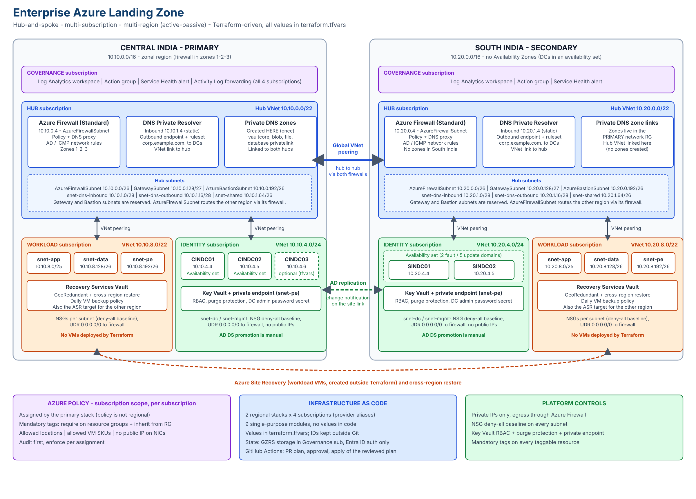

Editable vector version: [architecture.svg](images/architecture.svg).

## 1. Landscape
Four subscriptions per region; hubs connected by global VNet peering.

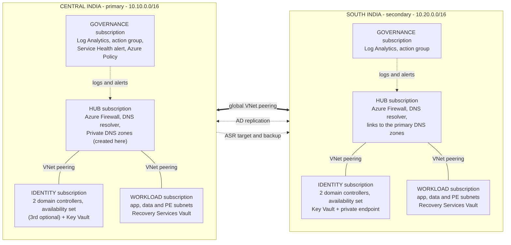

## 2. Network topology
Hub-and-spoke per region with Azure Firewall and DNS Private Resolver in each hub.

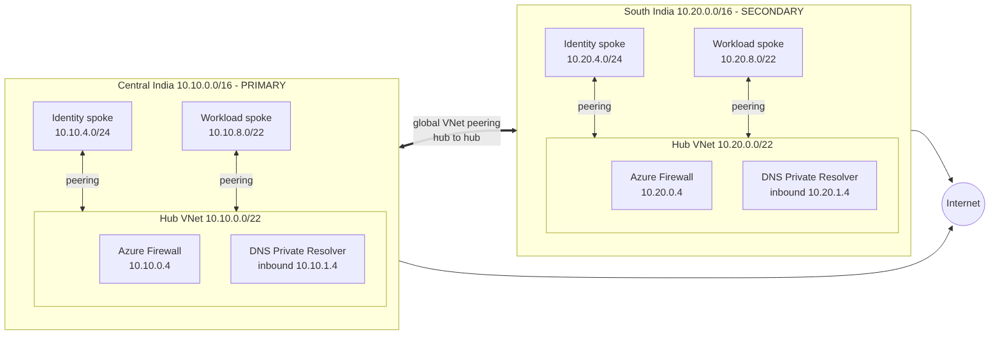

## 3. DNS resolution
Spoke VMs query the firewall DNS proxy, which forwards to the resolver; AD names go to the domain controllers, privatelink names to the Private DNS zones.

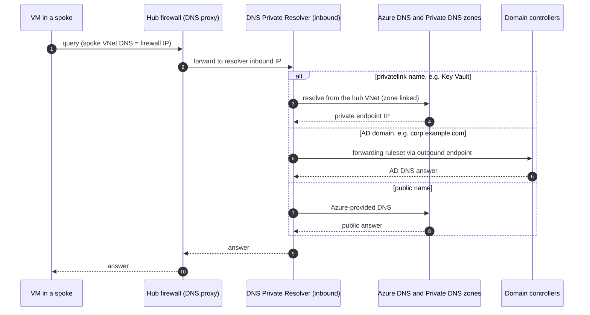

## 4. Cross-region traffic
Spoke traffic to the other region passes through both firewalls.

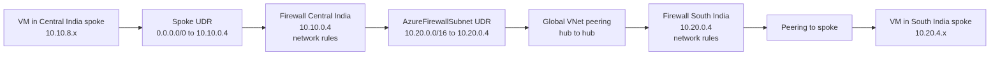

## 5. Identity and DR
Domain controllers in availability sets (optional third DC in Central India), one AD site per region with change notification on the site link.

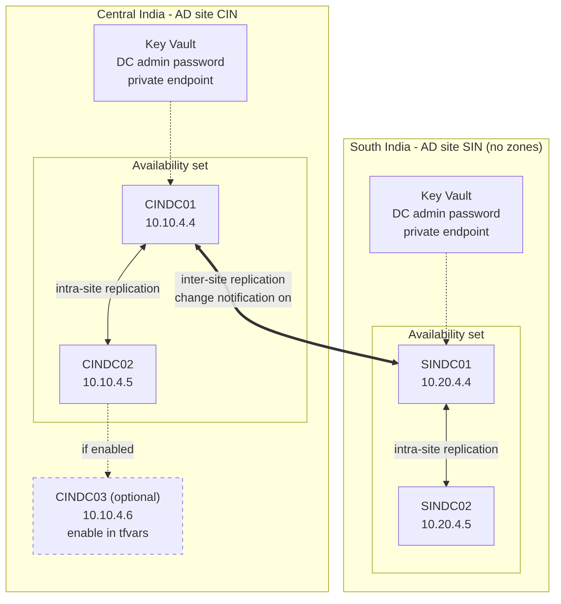

## 6. Deployment flow
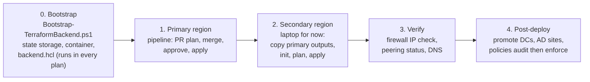

## 7. Terraform module dependencies
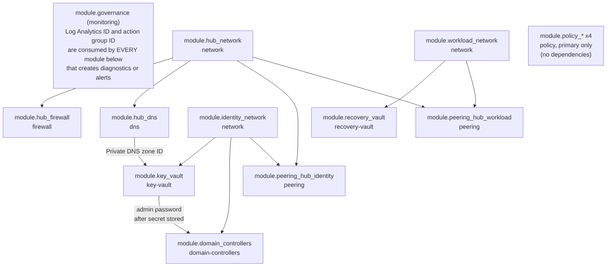

## 8. State and providers
One state file per stack in the governance subscription; four aliased providers per stack.

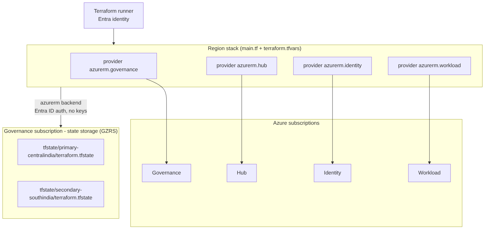

## 9. Policy model
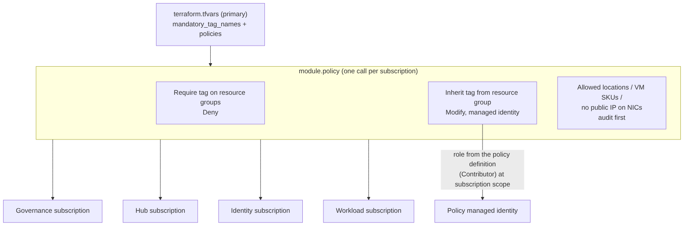

## 10. CI/CD pipeline
From feature branch to an approved apply of the reviewed plan. Details: [cicd-pipeline.md](cicd-pipeline.md).

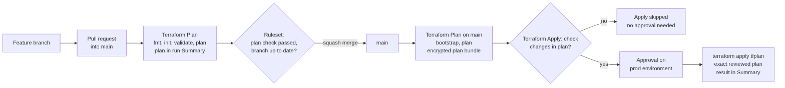

## 11. Failure scenarios
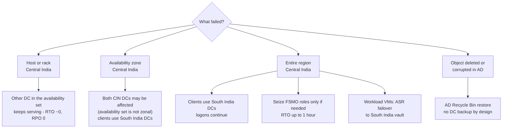
